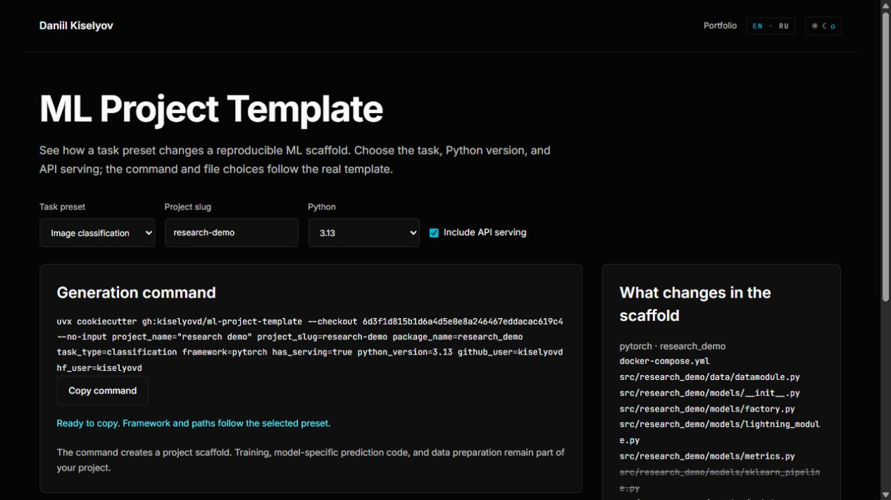

# ml-project-template

[CI](https://github.com/kiselyovd/ml-project-template/actions/workflows/ci.yml) · [MIT](LICENSE) · Python 3.12 / 3.13

A Cookiecutter engineering scaffold for ML projects with PyTorch Lightning / scikit-learn, Hydra, MLflow, DVC, FastAPI serving, Docker, CI/CD, and HuggingFace Hub publishing.

[](https://kiselyovd.github.io/showcase/ml-project-template/)

**[Explore the scaffold](https://kiselyovd.github.io/showcase/ml-project-template/)** — choose one of the five canonical task presets, API serving, and Python version. Inspect the source-derived file choices and copy a command pinned to the template revision.

**Russian version:** [README.ru.md](README.ru.md)

## Quick Start

```bash
pipx install cookiecutter
cookiecutter gh:kiselyovd/ml-project-template
cd my-new-project
make setup
make test
```

## Supported task types

| task_type | framework | notes |
|---|---|---|
| classification | pytorch | Image classification |
| segmentation | pytorch | Semantic segmentation |
| keypoints | pytorch / ultralytics | Keypoint detection |
| tabular | sklearn + lightgbm | No Lightning, simpler scaffold |
| nlp | pytorch + transformers | Text classification |

See [cookiecutter.json](cookiecutter.json) for all variables.

## License

MIT - see [LICENSE](LICENSE).
